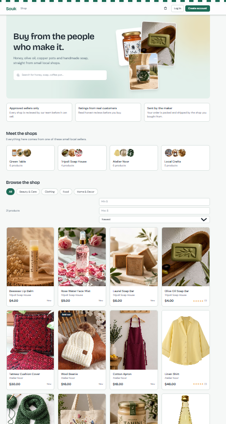
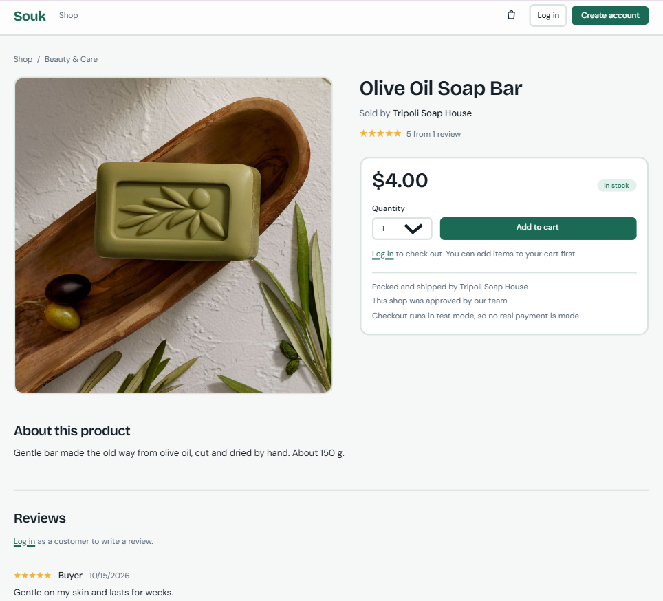
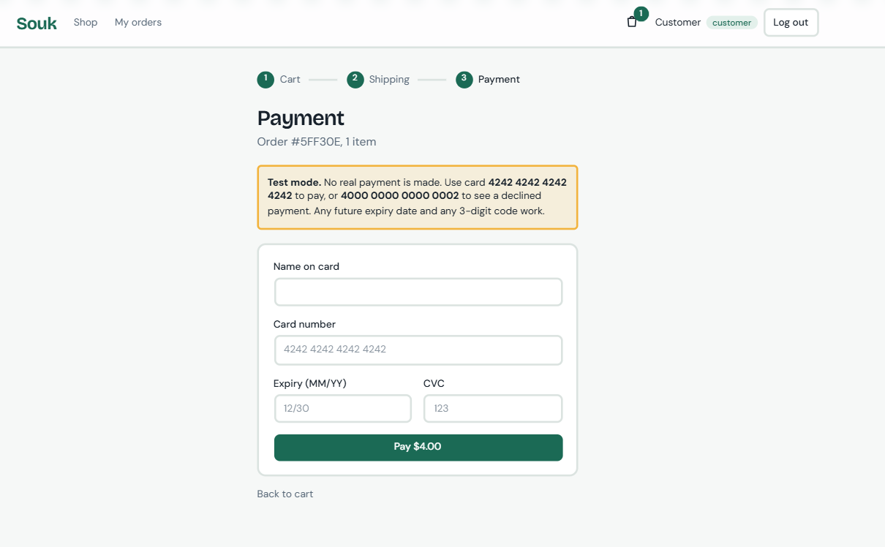
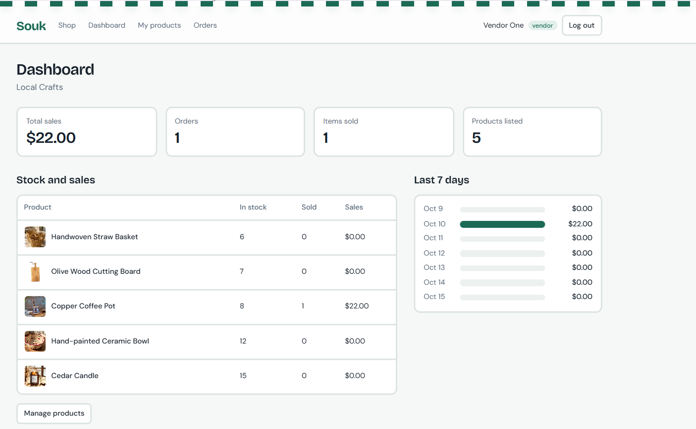
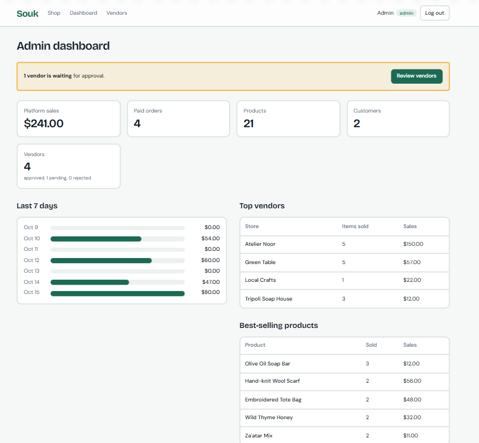
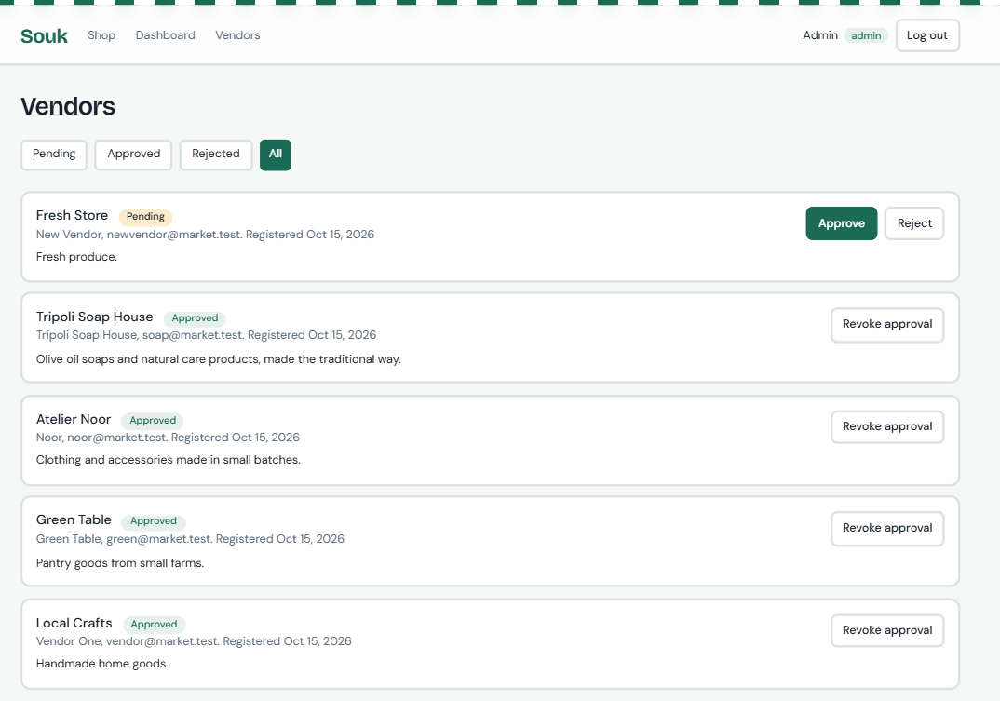

# Souk: Multi-Vendor E-Commerce Marketplace

Souk is a marketplace where small local sellers list products and customers browse, pay and track their orders. An admin approves new sellers and watches the whole platform.

Built with **Next.js, Node.js + Express, MongoDB, Redux Toolkit** and JWT authentication.

## Screenshots

| Shop | Product page |
|---|---|
|  |  |

| Checkout and payment | Vendor dashboard |
|---|---|
|  |  |

| Admin dashboard | Vendor approval |
|---|---|
|  |  |

## Features

**Customers**
- Register and log in, with a cart that is saved in the browser and survives a refresh
- Browse the catalog with search, category filter, price range, sorting and pagination
- Filter by seller with the "Meet the shops" section
- Read and write reviews with 1 to 5 star ratings (one review per product, editable and deletable)
- Check out with a shipping address and a test-mode card payment
- Track every order item: placed, shipped, delivered

**Vendors**
- Register a shop (it starts as *pending* until an admin approves it)
- Add, edit and delete products with up to 4 photos, and remove or add photos when editing
- Dashboard with total sales, orders, items sold, sales for the last 7 days, and a stock table with low-stock and out-of-stock warnings
- Orders page to mark items as shipped and delivered

**Admin**
- Approve, reject or revoke vendors (rejected vendors' products disappear from the shop and cannot be bought)
- Platform report: sales, paid orders, products, customers, top vendors, best-selling products, last 7 days

**Interface**
- Responsive layout, a market-stall awning theme and four switchable color themes (the dots in the footer)
- Animations that respect the "reduce motion" system setting
- Loading placeholders, empty states and a custom 404 page

## Tech stack

| Part | Technology |
|---|---|
| Frontend | Next.js (App Router), React, Tailwind CSS, Redux Toolkit, Axios |
| Backend | Node.js, Express |
| Database | MongoDB with Mongoose (MongoDB Atlas) |
| Auth | JWT, bcrypt password hashing, role-based middleware |
| Uploads | Multer and Sharp (photos are resized, then stored in MongoDB) |
| Security | Helmet, rate limiting, CORS allow-list, input validation |

## Run it locally

You need **Node.js 20 or newer** and a free **MongoDB Atlas** cluster (or a local MongoDB).

**1. Backend**

```bash
cd server
cp .env.example .env     # on Windows PowerShell: copy .env.example .env
```

Open `.env` and fill in:
- `MONGO_URI`: your Atlas connection string, with the database name `marketplace` before the `?`
- `JWT_SECRET`: a long random string. You can generate one with
  `node -e "console.log(require('crypto').randomBytes(48).toString('hex'))"`

Then:

```bash
npm install
npm run seed             # creates demo accounts, products, reviews and orders
npm run dev              # check http://localhost:5000/api/health
```

Atlas must allow your IP address under *Network Access*.

**2. Frontend** (in a second terminal)

```bash
cd client
npm install
npm run dev              # open http://localhost:3000
```

The frontend talks to `http://localhost:5000` by default. To use another address, create `client/.env.local` containing `NEXT_PUBLIC_API_URL=https://your-backend-address`.

## Demo accounts

These are created by `npm run seed`.

| Role | Shop | Email | Password |
|---|---|---|---|
| Admin | | admin@market.test | admin123 |
| Vendor | Local Crafts | vendor@market.test | vendor123 |
| Vendor | Green Table | green@market.test | green123 |
| Vendor | Atelier Noor | noor@market.test | noor123 |
| Vendor | Tripoli Soap House | soap@market.test | soap123 |
| Vendor (pending approval) | Fresh Store | newvendor@market.test | test1234 |
| Customer | | customer@market.test | customer123 |
| Customer | | buyer@market.test | buyer123 |

The demo data holds 8 users, 4 categories, 21 products, 10 reviews and 5 orders in different states (delivered, shipped, placed and one unpaid).

`npm run seed` **deletes everything** in the database first, then recreates this data.

### Product photos

By default the demo products have no photos and show a plain letter tile. To add your own:
- **In bulk:** put image files in `server/seed-images/`, named after the product (the list is in the README.txt inside), then run `npm run seed`. Photos of any size work, because they are resized automatically.
- **One at a time:** log in as a vendor, open **My products**, click **Edit**, and add or remove photos.
- **Colored placeholders instead:** run `npm run seed -- --placeholders`.

## Payments (test mode)

Stripe is not available in the author's country, so payments go through a **simulated test-mode gateway** (`server/services/paymentGateway.js`). It follows the flow of a hosted checkout: the server creates the order, the customer pays on a separate payment page, and the order is confirmed only after a successful charge.

| Card number | Result |
|---|---|
| `4242 4242 4242 4242` | Payment succeeds |
| `4000 0000 0000 0002` | Card declined |

Use any future expiry date and any 3-digit CVC. No real payment is ever made, and full card numbers are never stored (only the last 4 digits). The gateway lives in a single file, so a real provider such as Stripe could replace it without touching the rest of the code.

## Automated check

With the backend running and freshly seeded:

```bash
cd server
npm run smoke
```

It runs about 40 checks covering logins, the catalog, role permissions, buying, stock, reviews, order fulfilment, dashboards and vendor approval, and prints PASS or FAIL for each. Run `npm run seed` afterwards to reset the demo data.

## How it works

- **Prices are never trusted from the browser.** At checkout the server rebuilds the order from the database, so a changed price in the browser has no effect.
- **No overselling.** Stock is reserved with an atomic update when payment starts, and given back if the payment is declined.
- **One order, many vendors.** Each order item stores its vendor and its own status, so every seller ships and tracks only their own items. A vendor's dashboard and order list are filtered by item.
- **Roles are enforced on the server.** Customers, vendors and admins are separated by middleware, vendors can sell only after admin approval, and nobody can register as an admin.
- **Images live in MongoDB** (4 per product). Uploads up to 10 MB are resized to at most 1200 px and compressed, so phone photos stay small and the app needs no external file storage.
- **Security basics:** hashed passwords, expiring tokens, rate-limited login, security headers, request size limits and a CORS allow-list.

## API overview

| Area | Endpoints |
|---|---|
| Auth | `POST /api/auth/register`, `POST /api/auth/login`, `GET /api/auth/me` |
| Products | `GET /api/products` (search, category, minPrice, maxPrice, vendor, sort, page, limit), `GET /api/products/:id`, `GET /api/products/mine`, `POST /api/products`, `PUT /api/products/:id`, `DELETE /api/products/:id` |
| Reviews | `GET` and `POST /api/products/:id/reviews`, `DELETE /api/reviews/:id` |
| Categories | `GET /api/categories`, `POST /api/categories` (admin) |
| Images | `GET /api/images/:id` |
| Orders | `POST /api/orders`, `POST /api/orders/:id/pay`, `GET /api/orders/mine`, `GET /api/orders/vendor`, `GET /api/orders/:id`, `PATCH /api/orders/:id/items/:itemId/status` |
| Vendor | `GET /api/vendor/stats` |
| Admin | `GET /api/admin/vendors`, `PATCH /api/admin/vendors/:id/status`, `GET /api/admin/stats` |

## Project structure

```
server/
  config/        database connection
  models/        User, Product, Category, Review, Order, Image
  controllers/   route logic
  routes/        Express routers
  middleware/    auth (protect, authorize), photo upload
  services/      payment gateway (simulated)
  utils/         image resizing, vendor checks, dashboard helpers
  scripts/       seed.js, smoke-test.js
  seed-images/   your product photos for the demo data
client/
  app/           pages: shop, product, cart, checkout, pay, orders, vendor, admin, login, register
  components/    shared UI: navbar, cards, footer, theme switcher, illustrations
  store/         Redux Toolkit (auth and cart)
  lib/           API client and helpers
```

## Known limitations

- The payment gateway is a simulation, not a real payment provider.
- No email notifications, password reset, order cancellation or refunds.
- Product photos are stored in the database, which suits a demo but not a very large catalog.
- Shipping cost and taxes are not calculated.

## Author

Built by **[your name]** as the Multi-Vendor E-Commerce Marketplace project.
